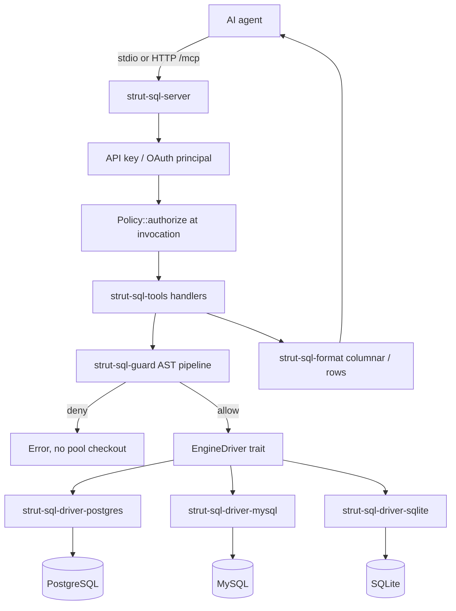

# Architecture — strut-stack-sql 2.0.0

## Purpose

Expose PostgreSQL, MySQL, and SQLite to AI agents over the
[Model Context Protocol](https://modelcontextprotocol.io) with:

- a small default tool surface and columnar results (token efficiency);
- one AST guard for every SQL path (safety);
- an engine-neutral driver contract (pluggable engines);
- per-principal authorization on stdio and HTTP (identity, not just transport).

## High-level flow



## Workspace layout

One workspace, one shipped binary (`strut-stack-sql`). Ten crates carry the
product; the binary crate is a thin entry point.

```
src/                    # binary: CLI parse, tracing, transport choice
crates/
  strut-sql-driver-api/         # EngineDriver contract, neutral types
  strut-sql-driver-postgres/    # PostgreSQL driver
  strut-sql-driver-mysql/       # MySQL driver
  strut-sql-driver-sqlite/      # SQLite driver
  strut-sql-driver-conformance/ # Driver Conformance Test Kit
  strut-sql-core/               # config, registries, Principal/Policy, pools
  strut-sql-guard/              # classification, denylist, LIMIT, placeholders
  strut-sql-format/             # columnar/rows, pagination, truncation
  strut-sql-tools/              # the 20 tool handlers
  strut-sql-server/             # rmcp stdio + Streamable HTTP, auth, health
```

Dependency rule: a database library (for example `sqlx`) may appear only in a
driver crate. Core, guard, format, tools, and server operate on the neutral
types from `strut-sql-driver-api`.

## Key types

| Type | Crate | Role |
|---|---|---|
| `EngineDriver` | `strut-sql-driver-api` | Engine contract: pool, execute, introspection, explain, dialect |
| `SqlValue`, `ColumnMeta`, `PlanTree` | `strut-sql-driver-api` | Engine-neutral value and plan types |
| `AppConfig` | `strut-sql-core` | Validated runtime settings, sources, policy |
| `Principal`, `Policy`, `Tier` | `strut-sql-core` | Caller identity and grants (`read < writes < ddl < admin`) |
| `PreparedSql` | `strut-sql-guard` | Guard-approved SQL + classification + LIMIT decisions |
| `ColumnarResult` | `strut-sql-format` | Token-efficient result payload |
| `McpSqlServer` | `strut-sql-server` | MCP service, invocation authorization, transports |

## Request path (`execute_sql`)

1. Resolve `source` to a configured `ResolvedSource` (unknown name is a validation error).
2. Classify the SQL recursively and enforce the required tier; derive the effective grant for the authenticated principal.
3. `authorize(principal, tool, source, tier)` at the invocation boundary — the same function used by `list_tools`.
4. Parse with the engine dialect, reject unsupported statements, deny dangerous functions, inject/clamp LIMIT on the AST.
5. On deny: return a typed error **without** checking out a pool connection.
6. Bind parameters through the driver's neutral codec; execute with the per-source timeout.
7. Decode rows to neutral values, format columnar/rows, truncate per cell and per result.
8. Emit one structured audit event; return the MCP text content block.

## Batch path

`execute_sql(queries: [...])` validates each item independently, preserves input
order while running with bounded concurrency, and enforces the configured
statement count, total deadline, and cross-item byte ceiling. Failures are
fail-soft per item unless `--fail-fast`.

## Authorization path

- **stdio**: a synthesized local operator principal uses the same
  `Policy::authorize` code path as HTTP; there is no bypass.
- **HTTP API key**: token name → principal id, token mode → maximum tier,
  optional source allowlist → grants. Secrets may be stored as
  `sha256:<hex>` and are compared in constant time.
- **OAuth 2.1**: RS256 JWT validation against the issuer's JWKS
  (`iss`/`aud`/`exp`), with the principal id from a configurable claim.
- **Admin gate**: `GRANT`/`REVOKE` require the Admin tier and
  `--allow-grants`; a DDL grant alone never widens to privilege management.

## Transports

| Mode | Flag | Notes |
|---|---|---|
| stdio | (default) | MCP over stdin/stdout; diagnostics and audit on stderr |
| Streamable HTTP | `--http 127.0.0.1:8080` | `/mcp`, `/livez`, `/readyz`, OAuth resource metadata; sessions bound to a principal |

The server pins MCP specification **2025-06-18**. Older requested versions are
answered with 2025-06-18; unsupported `MCP-Protocol-Version` headers are
rejected with 400; JSON-RPC batches are rejected.

## Distribution

| Channel | Artifact / entry |
|---|---|
| GitHub Releases | `strut-stack-sql-<platform>` archives, `.mcpb` bundles, `SHA256SUMS` |
| curl installer | [`install.sh`](../install.sh) |
| Homebrew | [`packaging/homebrew/strut-stack-sql.rb`](../packaging/homebrew/strut-stack-sql.rb) |
| Scoop / winget | [`packaging/scoop/`](../packaging/scoop/), [`packaging/winget/`](../packaging/winget/) |
| Docker | [`Dockerfile`](../Dockerfile) → `ghcr.io/rzlco666/strut-stack-sql` |
| MCP Registry | [`server.json`](../server.json) + [`mcpb/manifest.json`](../mcpb/manifest.json) |

See [INSTALL.md](INSTALL.md) and [MCP_REGISTRY.md](MCP_REGISTRY.md).

## Local development

| Component | Path |
|---|---|
| Compose stack | [`docker-compose.yml`](../docker-compose.yml) |
| Seed SQL | [`docker/seed/`](../docker/seed/) |
| Dev Container | [`.devcontainer/`](../.devcontainer/) |
| Conformance gate | [`scripts/conformance/run.sh`](../scripts/conformance/run.sh) |
| Benchmark harness | [`scripts/benchmark/run-bench.sh`](../scripts/benchmark/run-bench.sh) |

PostgreSQL is exposed on host port **5433**, MySQL on **3307** (avoids
conflicts with local installations).
